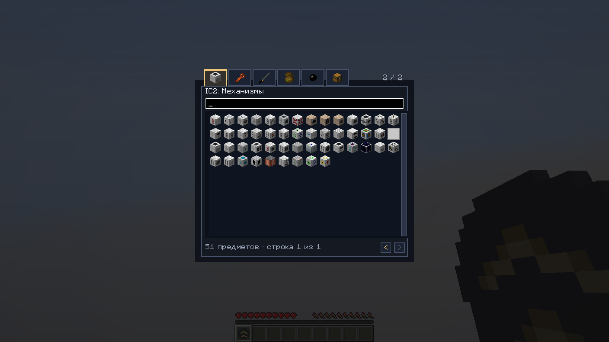
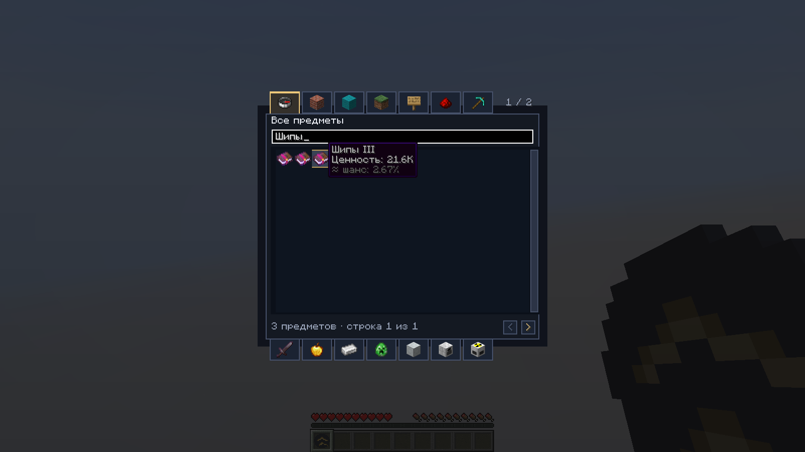
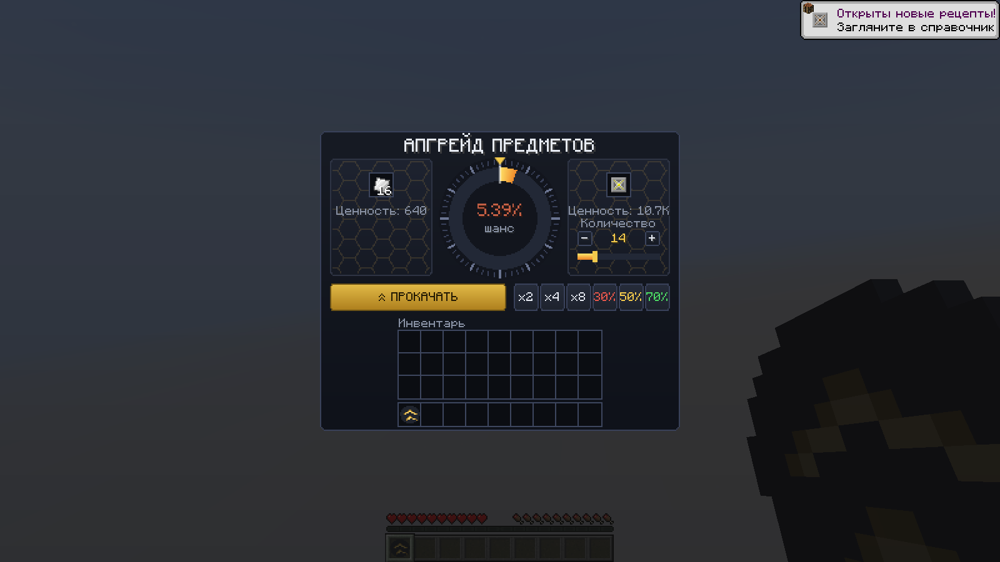

# IC2 — Upgrader Compatibility · Minecraft 26.3

Аддон для **Upgrader**, который добавляет совместимость с [IndustrialCraft 2 для Fabric 26.3 от CoreX3D](https://github.com/CoreX3D/ic2-fabric-26.3). Он учитывает рецепты и износ предметов IC2 при оценке стоимости и улучшает выбор приза в интерфейсе Апгрейдера.

Это отдельный аддон: для работы нужны **и наш порт IC2, и оригинальный Upgrader от EXEcheINZ**. Их JAR-файлы в этот репозиторий и релиз аддона не включены.

[Скачать аддон](https://github.com/CoreX3D/ic2-upgrader-compat-26.3/releases) · [Скачать совместимый IC2](https://github.com/CoreX3D/ic2-fabric-26.3/releases) · [Сообщить об ошибке](https://github.com/CoreX3D/ic2-upgrader-compat-26.3/issues)

## Возможности

- Оценка материалов, механизмов, брони и инструментов IC2 по цепочкам крафта и рецептам машин.
- Учёт остатка ресурса ядерного топлива, отражателей и расходуемых предметов.
- Категории с иконками, как в творческом режиме: обычные разделы Minecraft и отдельные разделы IC2.
- Поиск внутри категории и по всему каталогу, полоса прокрутки с перетаскиванием и поддержка колеса мыши.
- Все допустимые уровни зачарованных книг: например, «Шипы I–III» и «Защита I–IV». В проверенной ванильной конфигурации — **128 вариантов**; состав зависит от доступных зачарований мира.
- Цена книги растёт с уровнем зачарования, а сервер проверяет выбранный вариант и создаёт настоящую зачарованную книгу при выигрыше.
- Суммарная ценность выбранного количества: например, **14 × 764 = 10 696**, в карточке отображается **10.7K**.
- Предметы, числа и области клика отцентрированы в ячейках.
- Замена или удаление входного предмета и остановка крутилки происходят по одному подтверждению сервера. В конце слышен **один итоговый звук**.
- Цветное сообщение о выигрыше в общем чате: игрок, приз, количество, шанс и потраченные предметы. Подсказки предметов доступны при наведении.
- Русский и английский языки.



## Совместимые версии

| Компонент | Требуется / проверено |
| --- | --- |
| Minecraft | **26.3** |
| Java | **25 или новее**, проверено на 25 |
| Fabric Loader | **0.19.5 или новее**, проверено на 0.19.5 |
| Fabric API | Для Minecraft 26.3, **не ниже 0.163.0**; проверено на **0.164.0+26.3** |
| [IC2 Fabric от CoreX3D](https://github.com/CoreX3D/ic2-fabric-26.3) | **0.1.0-alpha.13**, точная зависимость |
| Оригинальный Upgrader от EXEcheINZ | **1.2.1**, файл `upgrader-fabric-1.2.1+26.3.jar` |
| Этот аддон | **0.1.6** |

Аддон обращается к реализации рецептов и компонентов указанного порта IC2. Совместимость с другими портами IC2 или версиями Upgrader не заявлена. Предыдущие аддоны 0.1.3–0.1.4 предназначены для IC2 alpha.12; для alpha.13 используйте 0.1.6.

## Установка

1. Полностью закройте Minecraft.
2. Установите Minecraft 26.3, Fabric Loader и подходящий Fabric API.
3. Положите в `mods` **все три файла**:

   ```text
   ic2-fabric-26.3-0.1.0-alpha.13.jar
   upgrader-fabric-1.2.1+26.3.jar
   ic2-upgrader-compat-26.3-0.1.6.jar
   ```

4. Уберите предыдущие версии IC2 и этого аддона, чтобы в `mods` оставалось по одной версии каждого мода.
5. Для сетевой игры установите одинаковые версии зависимостей и аддона **на сервер и на клиент каждого игрока**. В одиночной игре достаточно установки в профиль клиента.
6. Запустите игру и откройте обычный интерфейс Upgrader. Отдельный предмет для аддона не нужен.

IC2 можно получить в [релизах нашего порта](https://github.com/CoreX3D/ic2-fabric-26.3/releases). Оригинальный Upgrader получают отдельно у его автора; этот проект распространяет только собственный аддон. Архив `-sources.jar` предназначен для разработчиков и в `mods` не устанавливается.

## Книги, стоимость и настройки

Поиск понимает название зачарования, идентификатор и уровень: например, `Шипы 3` или `minecraft:protection`. Каждый вариант имеет собственные цену и шанс. Цена рассчитывается от базовой стоимости зачарованной книги в Upgrader с учётом коэффициента зачарования для наковальни; каждый следующий уровень стоит вдвое дороже предыдущего.



Аддон использует существующий `config/upgrader.json`. Параметры `valueOverrides`, `valueMultipliers`, `globalValueMultiplier` и пользовательский `blacklist` сохраняют действие. Параметры `houseEdge`, `minChance`, `maxChance`, длительность прокрутки и ограничение попыток остаются настройками Upgrader. Цены на предметы IC2 меняют итоговый шанс через штатный расчёт вероятности.

Оценка отражает приблизительную материальную стоимость для игровой рулетки. Электричество, время игрока и сложность автоматизации не переводятся в универсальную цену. Для ресурсов без полного детерминированного рецепта применяются явные базовые оценки. Для молота и кусачек учитывается цена одного использования, для возвращаемых ёмкостей — остатки рецепта, когда они описаны.

| Состояние предмета IC2 | Как учитывается |
| --- | --- |
| Урановые и MOX-стержни | Пропорционально остатку ресурса |
| Обычный и утолщённый нейтронные отражатели | Пропорционально остатку ресурса |
| Увлажняющая капсула | Пропорционально остатку расходуемых зарядов |
| Заряд EU оборудования | Не увеличивает цену и не считается постоянным износом |
| Нагрев элементов охлаждения | Не уменьшает материальную стоимость |
| Иридиевый отражатель | Штраф за износ отсутствует |

Выигранное электрическое оборудование выдаётся **разряженным**. Аддон не переносит заряд, жидкости, содержимое, записанные шаблоны или настройки пожертвованного предмета в выигрыш. Служебные `creative_generator`, `debug_item` и пакет семян без генетических данных `crop_seed_bag` исключены из каталога.



## Сборка из исходников

Нужен **JDK 25**. Создайте папку `deps/` в корне проекта и положите туда отдельно полученные зависимости:

```text
deps/ic2-fabric-26.3-0.1.0-alpha.13.jar
deps/upgrader-fabric-1.2.1+26.3.jar
```

Эти файлы используются только для компиляции и тестов. Они исключены из Git и не упаковываются в JAR аддона. Все ссылки на них в сборке относительные.

Windows PowerShell:

```powershell
.\gradlew.bat --no-daemon --no-parallel build
```

Linux / macOS:

```sh
chmod +x gradlew
./gradlew --no-daemon --no-parallel build
```

Результат: `build/libs/ic2-upgrader-compat-26.3-0.1.6.jar`.

Дополнительные проверки в отдельных тестовых мирах:

```powershell
.\gradlew.bat --no-daemon --no-parallel -PenableGameTests=true build runGameTest
.\gradlew.bat --no-daemon --no-parallel -PenableGameTests=true -PenableClientGameTests=true runClientGameTest
```

Для клиентских тестов нужны графическая среда и работающий игровой клиент. Флаг `--offline` применим после загрузки всех зависимостей. Необязательное свойство `-PfabricApiMirror=<путь>` указывает на Maven-репозиторий Fabric API с обычной Maven-структурой.

## Проверка релиза 0.1.6

23 октября 2026 года проверенная сборка прошла **34 серверных GameTest-проверки** и сценарий в настоящем клиенте Minecraft 26.3 с IC2 alpha.13, Fabric API 0.164.0+26.3 и 12 дополнительными модами, включая Sodium, Iris, Lithium, C2ME и Voxy.

Проверены категории, поиск, полоса прокрутки, 128 книг, цены, количество, центрирование, успешная выдача оборудования и объявления. Для синхронизации проверены выигрыш, проигрыш, выигрыш с тем же предметом, закрытие окна во время попытки, раннее завершение местного таймера, повторные и устаревшие пакеты. Предмет и крутилка завершаются вместе, а реальный игровой обработчик звука вызывается один раз. Рабочие миры и настройки не использовались.

Скриншоты выше сняты в тестовом клиенте. Они показывают интерфейс и конкретные тестовые цены, а не гарантированный шанс выигрыша. Подробнее об изменениях — в [CHANGELOG](CHANGELOG.md).

## Авторы и лицензии

Аддон разработан **CoreX3D** и распространяется по [MIT](LICENSE). Эта лицензия относится **только к коду аддона**.

Оригинальный **Upgrader создан EXEcheINZ** и распространяется по собственной лицензии **All Rights Reserved**. IndustrialCraft 2, его авторы, ресурсы и [наш порт IC2](https://github.com/CoreX3D/ic2-fabric-26.3) сохраняют собственные сведения об авторстве и лицензиях. Код и ресурсы этих модов здесь не распространяются. Gradle Wrapper сохраняет свою лицензию и служит только для запуска сборки.
